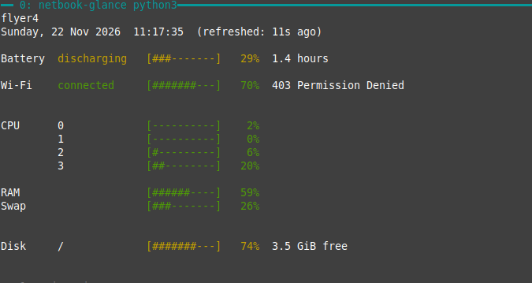

# netbook-glance



A small, keyboard-driven Linux terminal dashboard for seeing what's going on
at a glance. It was built for an older laptop with limited CPU and storage,
and works as a standalone program or inside a terminal multiplexer.

It shows battery, Wi-Fi, per-core CPU, memory, swap, and root filesystem use.
Press `r` to refresh and `q` to quit. The clock and refresh age update once a
second; measurements are otherwise collected only on request. The age turns
yellow after one minute and red after ten. Battery and Wi-Fi status and usage
bars use color where available, with text and percentages as a fallback.

## Install and run

The program needs Python 3 with `curses`. Battery information uses `upower`;
Wi-Fi uses NetworkManager's `nmcli`. Missing commands or devices display as
unavailable. It does not require sudo, pip, or a virtual environment.

```sh
git clone https://github.com/david-wolgemuth/netbook-glance.git ~/projects/netbook-glance
mkdir -p ~/.local/bin
ln -s ~/projects/netbook-glance/netbook-glance ~/.local/bin/netbook-glance
netbook-glance
```

Make sure `~/.local/bin` is on your `PATH`. Alternatively, run
`./netbook-glance` from the checkout. Update with `git pull` in the checkout;
restart the program to use the new version.

## How it works

The single Python script keeps collection, formatting, rendering, and input
handling separate. It reads CPU counters from `/proc/stat`, samples them half
a second apart, and computes per-core utilization. RAM usage is
`(MemTotal - MemAvailable) / MemTotal` from `/proc/meminfo`; swap uses the
same approach with its total and free values. Root disk use is calculated from
space available to the current user. `upower` reports the battery, and `nmcli`
reports the connected Wi-Fi network and cached signal without forcing a scan.
System commands have short timeouts.

On refresh, CPU is sampled first and displayed while the rest of the prior
snapshot remains visible. The completed snapshot then replaces the old one.
The short CPU sample can include brief spikes from any process; it is not a
long-term average. The terminal is redrawn on resize and restored on exit.

The display shows up to eight CPU cores. If the terminal is too short, a notice
at the bottom asks you to enlarge it; there is no scrolling yet. Longer details
wrap in narrow terminals. This has been exercised on flyer4 (Linux Mint 22)
but hardware and terminal behavior can vary.

## Development

Run the tests from the project directory:

```sh
python3 -m unittest -v test_netbook_glance
```

The dashboard deliberately has no background measurement polling, process
list, configuration framework, or tmux launcher. An optional slow auto-refresh
or process viewer could be explored later if useful.

## License

[MIT](LICENSE)
